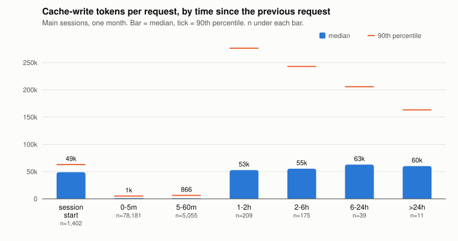
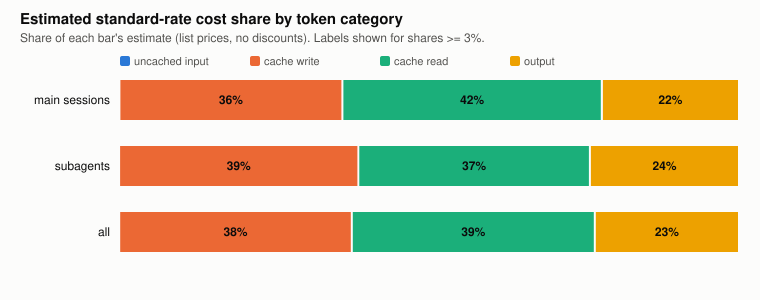
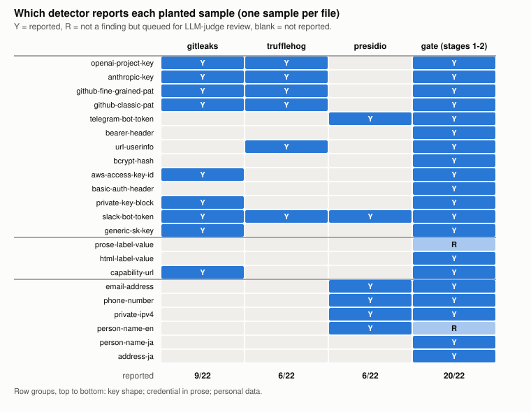

# 実測報告: 一人で運用する AI エージェント組織

**休止後のプロンプトキャッシュ書き直し、委譲の量、公開前の関門**

Kazuaand · 第 1.0.0 版 · 2026 年 11 月

> 英語版 `report.md` が正本です。数値・表・図は両版で同じものを使っています。

## 要旨

一人の運用者が、日々の仕事を AI コーディングエージェントの組織で回しました。タスクごとに主となるセッションが 1 つあり、それがモデルの格の違うサブエージェントに仕事を振り、返ってきた結果を確かめる形です。この報告は、その運用の実測を生のログとツール出力から数え直し、集計値だけで 3 つの観点にまとめたものです。

1. **休止後のキャッシュ書き直し。** 1 か月分のセッションログ (主セッション 1,402 本、リクエスト 85,072 件) で、プロンプトキャッシュの有効期限が切れた後に届いたリクエストは、キャッシュへの書き込みが中央値 55,961 トークンでした。期限内に届いたリクエストの 1,268 トークンの約 44 倍です。こうした「冷えた」リクエストは主セッションのリクエストの 0.5% にすぎませんが、主セッションのキャッシュ書き込みトークンの 12.1% を占めました。有効期限 1 時間のキャッシュは、前のリクエストから 5〜60 分空いて届いた 5,055 件を温かいまま保ちました。
2. **トークンと推定費用の行き先。** 全 296,381 件のうち、サブエージェントがリクエストの 71%、標準単価で換算した推定費用の約 59% を占めました。処理トークンの 97% はキャッシュ読み込みでしたが、推定費用ではキャッシュ書き込み (38%)・キャッシュ読み込み (39%)・出力 (23%) がそれぞれ大きな割合を持ち、キャッシュを通らない入力はほぼゼロでした。
3. **公開前の関門。** 合成した秘密情報・個人情報 22 件の検査用データに対し、広く使われている OSS 検出器 3 種は単独ではそれぞれ 6〜9 件しか報告せず、7 件はどれも報告しませんでした。4 段の関門を 3 つの repository に対して 7 回走らせたうち 4 回が FAIL で、3 回は判定役のプロセスが異常終了して安全側に止まったもの (うち 2 回は他の原因も併発)、1 回は公開用の名前を判定役が身元の開示と判断したものでした。3 つとも最終的に通過しました。

どの数値にも期間・条件・件数を付けています。分からない値は 0 にせず「不明」としています。集計データ、図、それらを作るスクリプトを同梱しています。

## 1. 背景

AI コーディングエージェントは、一人の助手としてではなく小さな組織として使われるようになっています。主となるセッションが目的と決定を持ち、範囲を区切った仕事をサブエージェントに渡し、返ってきたものを検証します。これを一人で回すと、実務上の問いが 2 つ出てきます。

- **費用の構造。** エージェントのセッションは、長く伸び続ける文脈をリクエストのたびに送り直します。提供元のプロンプトキャッシュがそれを安くしていますが、キャッシュには有効期限があります。休止の後に再開すると何が起きるのか。全体のうちサブエージェントはどれだけを占めるのか。
- **安全な公開。** こうして作ったメモや道具は共有する価値がありますが、非公開の作業環境の内側で書かれています。既製の検出器は外に出してはいけないものをどれだけ拾えるのか。より厳しい関門は実際にどう働くのか。

関連 repository の `publish-gate` (関門そのもの)、`graph-compound-engineering` (エージェントの仕事の組み立て方の手引き)、`awesome-ai-solopreneur` (厳選したリンク集) は参考文献に挙げました。4.3 節の関門の結果は、これらの最初の公開時のものです。この報告は方法の説明ではなく、実測を示すものです。

## 2. 対象

- **運用者と期間。** 運用者 1 人、作業用の機械 1 台、2026 年 10 月 (UTC の暦月)。運用者が使う他の機械は含みません。
- **エージェント。** Claude Code CLI のセッション。Claude の 4 つの格 (Fable・Opus・Sonnet・Haiku) のモデルを、さまざまな effort で使いました。主セッションはサブエージェントに委譲し、サブエージェントがさらに委譲することもあります。
- **キャッシュの設定。** 観測したログでは、キャッシュ書き込みはほぼすべて有効期限 1 時間のものでした (書き込みトークンの 99.7% が 1 時間、5 分のものは記録なし、残りはラベルなし)。
- **関門。** `publish-gate` の最初の公開版。段 1 = 秘密情報と個人情報の検出器 (gitleaks、検証なしの TruffleHog、Presidio、「ラベル → 値」や HTML タグを除いた再走査を含む独自パターン)、段 2 = 外から渡す禁止リスト、段 3 = tree だけを読み、理由付きで PASS/FAIL を返し点数は出さない、互いに独立した LLM 判定役 2 体 (両方の PASS が条件)、段 4 = 1 つでも FAIL なら公開しない。

## 3. 方法

### 3.1 セッションログ (4.1 節と 4.2 節)

`scripts/aggregate_sessions.py` が CLI の JSONL 記録を読み、集計表だけを書き出します。

- **リクエスト。** API 呼び出し 1 回で、request id で識別します。複数のログ行が同じ使用量記録を持つことがあるため、出力トークンが最大の記録を残します。重複した記録 (同じ request id) は 1 回だけ数えます。
- **期間。** タイムスタンプが 2026-10-01T00:00Z 以上 2026-11-01T00:00Z 未満のリクエスト。
- **間隔と温度 (主セッションのみ)。** 間隔 = 同じ主セッション内で、1 つ前のリクエストの開始から今回の開始まで。間隔が前のリクエストのキャッシュ書き込みの有効期限 (使用量記録にある 1 時間か 5 分) 以内なら「温かい」、超えていれば「冷えた」、セッションの最初のリクエストなら「セッション開始」とします。
- **推定費用。** 提供元が 2026 年 10 月に公開していたモデルごとの標準単価 (100 万トークンあたりの米ドル) を使い、キャッシュ書き込みは入力単価の 1.25 倍 (5 分) または 2 倍 (1 時間)、キャッシュ読み込みはモデルごとの倍率 (多くは 0.1 倍、現行の 2 モデルは 0.05 倍と 0.025 倍) で換算しました。ラベルのないキャッシュ書き込み (書き込みトークンの 0.3%) は 5 分の単価で換算しました。これは**標準単価で換算した概算**であり、実際の請求額ではありません。請求や契約の情報は使っておらず、報告もしません。本文とデータで示すのは割合だけで、トークンの総数や金額の総額は公開しません。

### 3.2 検出器の陽性対照 (4.3 節)

`scripts/detector_control.py` は、使い捨ての検査用データを作ります。1 ファイルに 1 件ずつ、合計 22 件で、3 つのグループに分かれます。認証情報の「鍵の形」13 件、文章や HTML の中に書かれた認証情報 3 件、個人情報 6 件 (うち 2 件は日本語) です。値は乱数ですが、各形式が公開している長さと文字種に合わせ、エントロピーや形式で判定する規則が公平に働くようにしました。実際に使える認証情報や実在の人物は含みません。各検出器を既定の規則で単独に走らせます。gitleaks 8.30.1 (`dir`)、TruffleHog 3.99.7 (`filesystem --no-verification`、通信なし)、Presidio Analyzer 2.2.366 と spaCy `en_core_web_sm` (URL・日時・国籍や宗教・政治的集団以外の何かを報告したら 1 と数える)。4 列目は、2 行だけの検査用禁止リストを使って関門の段 1〜2 (LLM 判定役なし) を走らせた結果です。

### 3.3 関門の実行記録 (4.3 節)

`scripts/aggregate_gate_runs.py` が関門の証拠ファイルを読み、件数だけを書き出します。各実行について、結果、段ごとの件数、判定役 2 体の判定、判定役が 1 件ずつ審査した個人情報認識器のヒット数、FAIL の原因の分類です。repository ごとに、最初の公開を通した実行までを数え、それ以降の実行は含みません。

## 4. 結果

### 4.1 休止後のキャッシュ書き直し

主セッション、2026 年 10 月: 1,402 セッション、85,072 リクエスト (`data/cache_by_class.csv`、`data/cache_by_gap.csv`)。

| リクエストの種類 | 件数 | キャッシュ書き込み 中央値 | 同 90 パーセンタイル | キャッシュ読み込み 中央値 | 主セッションの書き込みトークンに占める割合 |
|---|---:|---:|---:|---:|---:|
| セッション開始 | 1,402 | 48,850 | 62,963 | 23,061 | 23.1% |
| 温かい (有効期限内) | 83,236 | 1,268 | 5,115 | 199,640 | 64.8% |
| 冷えた (有効期限切れ) | 434 | 55,961 | 257,362 | 33,126 | 12.1% |



*図 1. 同じ主セッション内で前のリクエストからの経過時間ごとに見た、1 リクエストあたりのキャッシュ書き込みトークンの中央値 (棒) と 90 パーセンタイル (横線)。*

わかったこと:

- **冷えたリクエストは会話を書き直す。** 書き込みの中央値 (55,961) は新しいセッションの開始 (48,850) に近いものの、裾ははるかに重くなります (90 パーセンタイルで 257,362 対 62,963)。長く続いたセッションでは、積み上がった文脈をもう一度書く必要があるためです。読み込みの中央値は約 33,000 トークンで、同時に動いている他のセッションが共通のシステム部分を温かく保っていることと整合します。
- **冷えたリクエストは少ないが高くつく。** 0.5% のリクエストが書き込みトークンの 12.1% を生みました。1 件あたりでは、温かいリクエストの書き込み中央値の約 44 倍です。
- **5〜60 分の間隔は 1 時間の有効期限が支えた。** 前のリクエストから 5〜60 分空いて届いた 5,055 件 (5.9%) は、それでもキャッシュから読めていました (ヒット率の中央値 0.996)。これらの読み込みは、その月の主セッションのキャッシュ書き込み全体の約 4.3 倍にあたります (主セッションの読み込みトークンの 7.0%。`data/cache_by_gap.csv`・`data/composition.csv`・`data/token_mix.csv` から導出)。同じリクエストが起きたと仮定した、入力単価を単位とする大まかな反実仮想では、有効期限が 5 分ならこの分を書き直す必要があり、主セッションの書き込み 1 単位あたり約 4.3 × (1.25 − 約 0.075) ≈ 5.1 単位かかります。一方、主セッションのすべての書き込みに 1 時間分の割増を払った費用は 0.75 単位でした。この運用では 1 時間の有効期限が約 7 倍有利でした (約 0.075 は読み込み倍率 0.1・0.05・0.025 倍の大まかな混合で、両側とも同じ格の構成を仮定しています)。
- **手を打つべきは 1 時間を超える間隔。** 1〜2 時間 (209 件)、2〜6 時間 (175 件)、6〜24 時間 (39 件)、24 時間超 (11 件) のいずれも、1 件あたりの書き込み中央値は約 53,000〜63,000 トークンでした。実務では、主に長いセッションについて次の 2 つの運用規則を支持します。有効期限を過ぎて止まっているセッションに、ちょっとした追加の依頼を送らない (依頼はファイルに書き、新しいセッションで始める)。止まったままになりそうなセッションは閉じるか引き継ぐ。冷えた再開と新規開始の中央値は近く (55,961 対 48,850)、差が出るのは裾で、冷えた再開の 90 パーセンタイル (257,362) は新規開始 (62,963) の 4 倍です。新規セッションをどこまで小さく保てるかは、ここでは測っていません。

### 4.2 トークンと推定費用の行き先

全リクエスト、2026 年 10 月: 296,381 件 (主 85,072 件、サブエージェントのログ 6,089 本で 211,309 件) (`data/composition.csv`、`data/token_mix.csv`)。



*図 2. 標準単価で換算した推定費用の、トークンの種類ごとの割合。キャッシュを通らない入力は 3 本の棒のいずれでも 0.1% 未満。*

| 内訳 | リクエストの割合 | 推定費用の割合 |
|---|---:|---:|
| 主セッション | 28.7% | 41.0% |
| サブエージェント | 71.3% | 59.0% |
| Opus | 72.8% | 69.0% |
| Fable | 8.2% | 20.1% |
| Sonnet | 18.9% | 10.9% |
| Haiku | 0.1% | 0.1% 未満 |

わかったこと:

- **量の大半は委譲。** リクエストの 10 件に 7 件はサブエージェントでした。主セッションの費用の割合 (41%) がリクエストの割合 (29%) より大きいのは、一つには主セッションが最も単価の高い格をはるかに多く使うため (主セッションのリクエストの 27%、サブエージェントでは 1% 未満)、もう一つには主セッションの文脈が長いためです (リクエストあたりのキャッシュ読み込みは平均でサブエージェントの約 1.8 倍)。
- **トークンと費用は別の姿を見せる。** 処理トークンの 97.1% はキャッシュ読み込みで、キャッシュを通らない入力は 0.003%、キャッシュ書き込みは 2.3%、出力は 0.6% でした。推定費用では、キャッシュ書き込み (38%)・キャッシュ読み込み (39%)・出力 (23%) が同じ桁に並びます。書き込みを減らすこと (冷えた再開を減らす、大きな初期文脈を持つ新規セッションを増やしすぎない) は、読み込みを減らすことと同じくらい効きます。
- **単価の高い格は少なく使っても効く。** 最も単価の高い格はリクエストの 8% で、推定費用の約 20% を占めました。

### 4.3 公開前の関門

**検出器の陽性対照** (`data/detector_control.csv`、図 3)。



*図 3. 合成した各サンプルを、それぞれの道具が単独で報告したか。「R」は検出ではないが、LLM 判定役の 1 件ずつの審査に回ったもの。*

- 既定の規則で単独に走らせると、22 件のうち gitleaks は 9 件、TruffleHog は 6 件、Presidio は 6 件 (何らかの個人情報として) を報告しました。Presidio の正しい検出は、メールアドレス・電話番号・IP アドレス・英語の人名の 4 件で、残る 2 件は鍵の形を無関係な種類 (銀行口座番号や ID 番号) として報告したものでした。この偶然の検出は乱数の出方で変わり、検査用データの seed を変えると変わります。次の項目の件数は、この乱数での値です。
- 22 件のうち 7 件は、3 つの**どれも**報告しませんでした。bcrypt ハッシュ、Bearer トークンのヘッダー、HTTP Basic 認証のヘッダー、文章の中のパスワード、HTML の定義リストの中のパスワード、日本語の人名、日本語の住所です。共通するのは、3 つの道具のどれにもこれらの形 (ハッシュ、認証ヘッダー、ラベルのない文章) を拾う既定の規則がなく、既定の英語認識器が日本語を対象にしていないことです。
- 関門の段 1〜2 は 22 件中 20 件を報告し、残る 2 件を判定役の審査に回しました。そのうち 1 件は、ふつうの文で書かれたパスワード (「password」という語と値の間にアカウント名が入る英文) で、関門の「ラベル → 値」規則はこの言い回しに一致しませんでした。関門の後の版ではこの言い回しを拾う規則を足しています。ここの件数は、これらの実行で使った版のものです。20 件のうち 2 件 (日本語の人名と住所) は、検査用の禁止リストにその値そのものを載せていたから見つかったもので、それが無ければ関門の検出は 18 件です。関門のパターンはこれらの形の多くを想定して書かれているため、これは標本内の結果です。既知の形を拾えることは示しますが、未知の形を拾えることは示しません。
- 実務上の読み方: **1 つの検出器が何も報告しないことは、無いことの証拠にならない。** 同じ設定で、仕込んだ陽性対照をたった今報告できた時にだけ意味を持ちます。

**公開前の実行** (`data/gate_runs.csv`、`data/gate_stage1_by_rule.csv`)。3 つの repository で、それぞれ最初の公開までに 7 回:

| 結果 | 回数 | 原因 |
|---|---:|---|
| PASS | 3 | — (各 repository 1 回。公開を通した実行) |
| FAIL: 判定役のプロセス異常 | 3 | 判定役のプロセスが 1 つエラーで終了。関門はこれを FAIL として扱う (安全側に止まる)。1〜2 回目は実行中の tree の変化も記録し、1 回目は段 1〜2 でも FAIL (下記) |
| FAIL: 身元に関する判定 | 1 | 判定役 1 体が、公開用の名前を書いた 4 行を身元の開示と判断。どの名前が公開前提かを判定役に伝えることで解消 |

証拠ファイルから分かった他のこと:

- 関門自身の repository では、最初の実行で検査用データが段 1 (IP アドレス) と段 2 (禁止リストの項目) にも引っかかりました。偽の値を実行時に組み立てる形に検査用データを変えました。
- 通過した実行では、個人情報認識器が人名・組織名・地名など 839 件を 3 回の実行で検出しました。これらは自動で FAIL にも無視にもせず、1 件ずつ判定役 2 体に渡し、すべて問題なしと判定されました (リンク集や手引きに出てくる公開の名前と地名)。
- 公開前の自己検査 2 回では、段 1 の検出が 281 件と 338 件ありました。2 回目では 201 件 (59%) が URL・日付・国籍などの種類、110 件 (33%) が組織名・人名・地名で、ほとんどが公開リンクと公開の名前でした。このため公開版の関門は、認識器の出力を「無視」(個人情報ではない)、「即 FAIL」(メール・電話・IP・カードや ID の番号)、「判定役の審査」(名前と地名) に分け、黙って通る区分を作らないようにしています。
- 初期の版には解析の不具合があり、禁止リストの各規則の末尾の注記をパターンの一部として読んでいたため、どの規則も一致しえず、段 2 は常に 0 件でした。段 2 自身ではなく、禁止された文字列が素通りしたことに気づいた確認役が見つけました。公開版の自己テストは、禁止リストの陽性対照も仕込んでいます。

## 5. 限界

- **運用者 1 人、機械 1 台、1 か月。** 結果は 1 つの運用を表すもので、エージェントの仕事一般を表すものではありません。キャッシュの数値は、セッションがどれだけ止まるか、文脈がどれだけ伸びるかという働き方に左右されます。
- **ログに出ないもの。** 記録に書かれないサーバー側の道具が使ったトークン (たとえばセッションが相談する advisor モデル) は含まず、**不明**です。同じ期間に使った他のエージェント CLI と、他の機械のログも含みません。
- **費用は推定。** 標準単価での換算で、割引・契約条件・クレジット・実際の請求は反映していません。実際の請求はどちらの方向にもずれうるもので、報告しません。
- **冷えたリクエストの定義。** 温度は間隔と記録上のキャッシュ有効期限から推定しています。文脈の圧縮やモデル・道具の変更など、他の理由でキャッシュを外すこともあり、それらはその間隔の区分に入っています。「セッション開始」は期間内で最初のリクエストなので、期間より前に始まったセッションは、期間内の最初のリクエストを開始として数えています。
- **関門の標本は小さい。** 3 つの repository で 7 回。検出器の検査用データ 22 件は著者が選んだもので、関門の結果は標本内です。
- **打ち切り。** 関門の件数は各 repository の最初の公開で止めています。以降の公開や他の repository の実行は含みません。

## 6. 再現のしかた

必要なもの: Python 3.10 以上 (セッション・関門の実行記録・図は標準ライブラリのみ)。検出器の陽性対照には gitleaks、TruffleHog、Presidio Analyzer と spaCy `en_core_web_sm`。

```sh
# 1. セッションログ: Claude Code の "projects" ディレクトリを 1 つ以上渡す
python3 scripts/aggregate_sessions.py --since 2026-10-01 --until 2026-11-01 --out data <projects-dir> [...]

# 2. 検出器の陽性対照 (関門のソースディレクトリを渡すと 4 列目も出る)
python3 scripts/detector_control.py --out data/detector_control.csv [--gate-dir <publish-gate の checkout>]

# 3. 関門の証拠 (repository ごとに 1 つのサブディレクトリ)
python3 scripts/aggregate_gate_runs.py <evidence-dir> --out data/gate_runs.csv --stage1-out data/gate_stage1_by_rule.csv --until-published

# 4. 図
python3 scripts/make_figures.py --data data --out figures
```

スクリプトが書き出すのは集計表だけで、セッション ID・パス・プロンプト・検出された文字列は書きません。自分のログで走らせれば自分の数値が出ます。それが想定している使い方です。

**この報告に適用した確認。** 公開前に、この報告の tree を上で述べた関門で検査し、さらに作成に関わっていない別の読み手が、本文のすべての数値を CSV と照合し、身元につながる記述がないかを確かめました。

## データとコード

- `data/` — 集計済みの CSV (セッション単位・日単位・識別につながる行はなし。トークンと費用の列は総数でなく割合)。CC BY 4.0。
- `figures/` — `data/` から作った SVG の図。CC BY 4.0。
- `scripts/` — `data/` と `figures/` を作るスクリプト。MIT。

## 参考文献

- Anthropic. Prompt caching (キャッシュの有効期限と料金の倍率). https://platform.claude.com/docs/en/build-with-claude/prompt-caching
- Anthropic. Pricing. https://platform.claude.com/docs/en/about-claude/pricing
- gitleaks. https://github.com/gitleaks/gitleaks
- TruffleHog. https://github.com/trufflesecurity/trufflehog
- Microsoft Presidio. https://github.com/microsoft/presidio
- Kazuaand. publish-gate. https://github.com/Kazuaand/publish-gate
- Kazuaand. graph-compound-engineering. https://github.com/Kazuaand/graph-compound-engineering
- Kazuaand. awesome-ai-solopreneur. https://github.com/Kazuaand/awesome-ai-solopreneur
