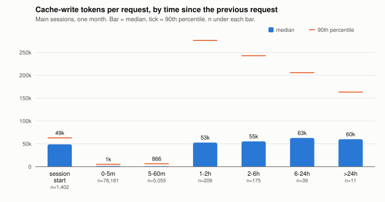
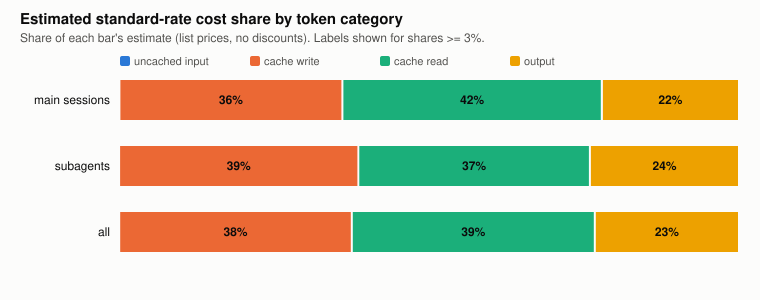
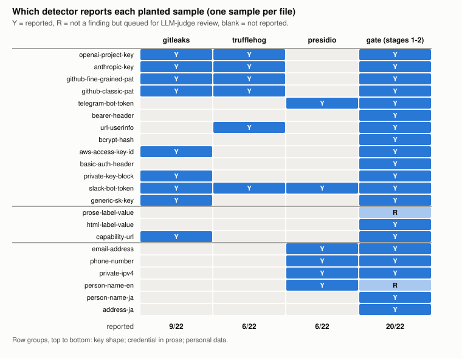

# Field report: running a one-person AI agent organization

**Prompt-cache cost after idle gaps, delegation volume, and a pre-publication gate**

Kazuaand · Version 1.0.0 · November 2026

## Abstract

One operator ran day-to-day work through an organization of AI coding agents: a lead session per task that delegates to subagents of different model tiers and checks their results. This report gives aggregate measurements from that practice, recounted from raw logs and tool output, in three areas.

1. **Cache rewrite after idle gaps.** Over one month of agent-CLI session logs (85,072 requests in 1,402 main sessions), a request that arrived after the prompt cache had expired wrote a median of 55,961 tokens to the cache, against 1,268 for a request that arrived while the cache was still warm (about 44 times more). Such "cold" requests were only 0.5% of main-session requests but produced 12.1% of all cache-write tokens in main sessions. A one-hour cache lifetime kept 5,055 requests that arrived 5–60 minutes apart warm.
2. **Where the tokens and the estimated cost go.** Across 296,381 requests, subagents made 71% of the requests and about 59% of the estimated standard-rate cost. Cache reads were 97% of all tokens processed, yet cache writes (38%), cache reads (39%) and output (23%) each carried a large share of the estimated cost; uncached input was negligible.
3. **A pre-publication gate.** On a fixture of 22 synthetic secrets and personal-data samples, three widely used open-source detectors each reported 6–9 samples when run alone, and 7 samples were reported by none of them. Over 7 release runs of a four-stage gate on three repositories, 4 runs failed: 3 in which a judge process errored and the gate failed closed (two of them also with other causes), 1 because a judge flagged the publishing pseudonym as an identity disclosure. All three repositories passed afterwards.

All numbers come with their period, conditions and sample size. Unknown values are marked as unknown, not zero. Aggregated data, figures and the scripts that produce them are included.

## 1. Background

AI coding agents are now used as a small organization rather than a single assistant: a lead session keeps the goal and decisions, hands bounded work to subagents, and verifies what comes back. Two practical questions follow for anyone running such a setup alone:

- **Cost structure.** Agent sessions resend a long, growing context on every request. Provider-side prompt caching makes this affordable, but caches expire. What does a session pay when it resumes after a pause, and how much of the total do subagents account for?
- **Publishing safely.** Notes and tools produced this way are worth sharing, but they are written from inside a private working environment. How well do off-the-shelf detectors catch what should not leave it, and what does a stricter gate do in practice?

The companion repositories `publish-gate` (the gate), `graph-compound-engineering` (a handbook for organizing agent work) and `awesome-ai-solopreneur` (a curated link collection) are listed in the references; the gate results in section 4.3 come from their first releases; this report gives measurements, not a method description.

## 2. Setting

- **Operator and period.** One operator, one workstation, October 2026 (UTC calendar month). Other machines the operator uses are not included.
- **Agents.** Claude Code CLI sessions using Claude models of four tiers (Fable, Opus, Sonnet, Haiku) at various effort levels. Lead sessions delegate to subagents, which may delegate further.
- **Cache configuration.** In the observed logs, cache writes were almost entirely one-hour entries (99.7% of cache-write tokens were labelled one-hour; no five-minute writes were recorded; the rest were unlabelled).
- **Gate.** The `publish-gate` tool, version used for its first public release: stage 1 = secret and PII detectors (gitleaks, TruffleHog without verification, Presidio, custom patterns including label→value and HTML-stripped rescans); stage 2 = an external denylist; stage 3 = two independent LLM judges that see only the tree, return PASS/FAIL with reasons and no score, and must both pass; stage 4 = any failure blocks publication.

## 3. Method

### 3.1 Session logs (sections 4.1 and 4.2)

The script `scripts/aggregate_sessions.py` reads the CLI's JSONL transcripts and writes only aggregated tables.

- **Request.** One API call, identified by its request id. Several log lines can share one usage record; the record with the largest output count is kept. Duplicate records (the same request id) are counted once.
- **Window.** Requests timestamped 2026-10-01T00:00Z to 2026-11-01T00:00Z.
- **Gap and temperature (main sessions only).** Gap = start-to-start time to the previous request of the same main session. A request is *warm* if the gap is within the lifetime of the previous request's cache write (one hour or five minutes, taken from the usage record), *cold* if it is longer, and *session start* if it is the first request of a session.
- **Estimated cost.** Standard first-party list prices per model (USD per million tokens, as published by the provider in October 2026), with cache writes at 1.25× (five-minute) or 2× (one-hour) the input price and cache reads at the provider's model-specific multiplier (0.1× for most models, 0.05× and 0.025× for two current models). Unlabelled cache writes (0.3% of write tokens) are priced at the five-minute rate. This is an *estimate at standard rates*: it is not what was billed, and no actual billing or plan data is used or reported. The report and the data give shares, not totals: absolute token sums and amounts are not published.

### 3.2 Detector positive control (section 4.3)

`scripts/detector_control.py` builds a throw-away fixture of 22 synthetic samples, one per file, in three groups: 13 credential "key shapes", 3 credentials written in prose or HTML, and 6 personal-data items (two of them in Japanese). Values are random but follow each format's published length and character set so that entropy- and format-based rules get a fair chance; nothing in the fixture is a working credential or a real person. Each detector runs alone with default rules: gitleaks 8.30.1 (`dir`), TruffleHog 3.99.7 (`filesystem --no-verification`, no network calls), Presidio Analyzer 2.2.366 with spaCy `en_core_web_sm` (counting any entity other than URL, date/time and nationality/religious/political group). A fourth column runs stages 1–2 of the gate (no LLM judges) with a two-line fixture denylist.

### 3.3 Gate runs (section 4.3)

`scripts/aggregate_gate_runs.py` reads the gate's evidence files and writes counts only: per run, the result, stage counts, both judge verdicts, the number of PII-recognizer hits passed to the judges for item-by-item review, and failure causes by category. Per repository, runs are counted up to and including the run that cleared its first public release; later runs are not included.

## 4. Results

### 4.1 Cache rewrite after idle gaps

Main sessions, October 2026: 1,402 sessions, 85,072 requests (`data/cache_by_class.csv`, `data/cache_by_gap.csv`).

| Request class | n | Cache write, median | Cache write, p90 | Cache read, median | Share of main-session cache-write tokens |
|---|---:|---:|---:|---:|---:|
| Session start | 1,402 | 48,850 | 62,963 | 23,061 | 23.1% |
| Warm (gap within cache lifetime) | 83,236 | 1,268 | 5,115 | 199,640 | 64.8% |
| Cold (gap beyond cache lifetime) | 434 | 55,961 | 257,362 | 33,126 | 12.1% |



*Figure 1. Median (bar) and 90th percentile (tick) of cache-write tokens per request, by time since the previous request in the same main session.*

Observations:

- **A cold request rewrites the conversation.** Its median write (55,961) is close to a fresh session start (48,850), but its tail is far heavier (p90 257,362 against 62,963), because a long-running session's accumulated context has to be written again. Its median cache read stays around 33,000 tokens, consistent with a shared system prefix that other concurrent sessions keep warm.
- **Cold requests are rare but expensive.** 0.5% of requests produced 12.1% of cache-write tokens. Per request, a cold write is about 44 times the median warm write.
- **The one-hour lifetime did the work in the 5–60 minute range.** 5,055 requests (5.9%) arrived 5–60 minutes after the previous one and still read from cache (median hit ratio 0.996). Their cache reads add up to about 4.3 times all main-session cache writes in the month (7.0% of main-session read tokens; derived from `data/cache_by_gap.csv`, `data/composition.csv` and `data/token_mix.csv`). A rough counterfactual in units of the input price, assuming the same requests would have occurred: with a five-minute lifetime those reads would have had to be rewritten, costing about 4.3 × (1.25 − ~0.075) ≈ 5.1 units per unit of main-session writes, whereas the one-hour premium on all main-session writes cost 0.75 units. The one-hour lifetime was favorable by roughly a factor of seven in this workload. (~0.075 is a rough blend of the 0.1×, 0.05× and 0.025× read multipliers; both sides assume the same tier mix.)
- **Gaps longer than an hour are where to act.** Gaps of 1–2 h (209), 2–6 h (175), 6–24 h (39) and over 24 h (11) all showed medians of about 53,000–63,000 written tokens per request. In practice this supports two operating rules, mainly for long sessions: do not send a quick follow-up into a session that has been idle past its cache lifetime (write the follow-up to a file and start a fresh session instead), and close or hand off sessions that are expected to sit idle. The medians of a cold resume and a fresh start are close (55,961 vs 48,850); the saving is in the tail, where a cold resume's p90 write (257,362) is four times a session start's (62,963). How small a fresh session can be kept is not measured here.

### 4.2 Where the tokens and the estimated cost go

All requests, October 2026: 296,381 requests (85,072 main, 211,309 subagent in 6,089 subagent logs) (`data/composition.csv`, `data/token_mix.csv`).



*Figure 2. Share of the estimated standard-rate cost by token category. Uncached input is below 0.1% in each of the three bars.*

| Breakdown | Share of requests | Share of estimated cost |
|---|---:|---:|
| Main sessions | 28.7% | 41.0% |
| Subagents | 71.3% | 59.0% |
| Opus tier | 72.8% | 69.0% |
| Fable tier | 8.2% | 20.1% |
| Sonnet tier | 18.9% | 10.9% |
| Haiku tier | 0.1% | < 0.1% |

Observations:

- **Delegation is the bulk of the volume.** Subagents made seven of every ten requests. The lead sessions' share of cost (41%) is higher than their share of requests (29%), partly because lead sessions use the highest-priced tier far more often (27% of main-session requests against under 1% of subagent requests) and partly because lead contexts are longer (cache read per request about 1.8 times that of subagents on average).
- **Tokens and cost tell different stories.** Cache reads were 97.1% of all tokens processed, uncached input 0.003%, cache writes 2.3%, output 0.6%. In estimated cost, cache writes (38%), cache reads (39%) and output (23%) are of the same order. Reducing writes (fewer cold resumes, fewer fresh sessions with large bootstrap context) matters as much as reducing reads.
- **Higher-priced tiers are used sparingly but count.** The highest-priced tier made 8% of requests and about 20% of the estimated cost.

### 4.3 The pre-publication gate

**Detector positive control** (`data/detector_control.csv`, Figure 3).



*Figure 3. Which tool reports each synthetic sample when run alone. "R" = not a finding, but queued for the LLM judges' item-by-item review.*

- Run alone with default rules, gitleaks reported 9 of 22 samples, TruffleHog 6, Presidio 6 (any personal-data entity). Presidio's four correct hits were the e-mail address, phone number, IP address and English name; its other two were key shapes reported under unrelated entity types (bank-account or ID-number). Such incidental hits depend on the random characters drawn and change with the fixture's seed; the counts in the next bullet are therefore specific to this draw.
- 7 of 22 samples were reported by **none** of the three: a bcrypt hash, a Bearer token header, an HTTP Basic-auth header, a password in a prose sentence, a password in an HTML definition list, a Japanese personal name and a Japanese address. The common thread is that none of the three tools has a default rule for these forms (hashes, authorization headers, unlabelled prose), and the default English recognizers do not cover Japanese text.
- Stages 1–2 of the gate reported 20 of 22 and queued the other 2 for judge review. One of the two is a password stated in a plain sentence, with the account name between the word "password" and the value: the gate's label→value rule did not match that phrasing. A later version of the gate adds a rule for it; the counts here are from the version used in these runs. Two of the 20 (the Japanese name and address) were found only because the fixture denylist lists those exact values; without it the gate reports 18. This is an in-sample result — the gate's own patterns were written with most of these shapes in mind — so it shows coverage of known shapes, not detection of unknown ones.
- Practical reading: **an empty report from one detector is not evidence of absence.** It means something only when the same configuration has just reported a planted positive control.

**Release runs** (`data/gate_runs.csv`, `data/gate_stage1_by_rule.csv`). Seven runs over three repositories, up to each one's first publication:

| Outcome | Runs | Cause |
|---|---:|---|
| PASS | 3 | — (one per repository; the run that cleared its release) |
| FAIL: judge process error | 3 | One judge process exited with an error; the gate treats this as FAIL (fail-closed). Runs 1–2 also recorded the tree changing during the run; run 1 also failed stages 1–2 (see below) |
| FAIL: identity judgement | 1 | One judge flagged four lines naming the publishing pseudonym as an identity disclosure; resolved by telling the judges which pseudonym is public by design |

Other observations from the evidence files:

- In the gate's own repository, the first run also tripped stage 1 (an IP address) and stage 2 (a denylist entry) on its test fixture; the fixture was changed to assemble its fake values at run time.
- In the passing runs, the PII recognizers produced 839 person/organization/location (and similar) hits across the three runs; these are not automatically failed or ignored but are each passed to both judges, and all were judged acceptable (public names and places in a link collection and a handbook).
- Before release, two self-check runs reported 281 and 338 stage-1 findings. In the second, 201 (59%) were URLs, dates or nationality-type entities and 110 (33%) were organization, person or location names — mostly public links and public names. This is why the released gate splits recognizer output into *ignored* (not personal data), *immediate fail* (e-mail, phone, IP, card and ID numbers) and *judge review* (names and places), with no category that passes silently.
- A parsing defect in an early version read every denylist rule's trailing comment as part of the pattern, so none of the rules could ever match and stage 2 reported zero findings. It was caught by a reviewer noticing a forbidden string passing, not by the stage itself; the released self-test now plants denylist positives as well.

## 5. Limitations

- **One operator, one machine, one month.** Results describe one practice, not agent workloads in general. Work patterns (how often sessions pause, how long contexts grow) drive the cache numbers.
- **What the logs do not show.** Tokens consumed by server-side tools that are not written to the transcripts (for example an advisor model consulted by a session) are not included and are **unknown**. Other agent CLIs used in the same period are not included. Logs on other machines are not included.
- **Cost is an estimate.** List prices at standard rates; no discounts, plan terms, credits or actual charges. Real billing may differ in either direction and is not reported.
- **Cold-request definition.** Temperature is inferred from gaps and the recorded cache lifetime. A request can also miss the cache for other reasons (context compaction, model or tool changes); these are counted in whichever gap class they fall into. "Session start" is the first request of a session inside the window, so a session that began before the window counts its first in-window request as a start.
- **Small gate sample.** Seven release runs on three repositories; the detector fixture has 22 samples chosen by the author. The gate's result on the fixture is in-sample.
- **Cut-off.** Gate counts stop at each repository's first release; runs for later releases and other repositories are not included.

## 6. Reproducing

Requirements: Python 3.10+ (standard library only for sessions, gate runs and figures); for the detector control, gitleaks, TruffleHog and Presidio Analyzer with spaCy `en_core_web_sm`.

```sh
# 1. Session logs: pass one or more Claude Code "projects" directories.
python3 scripts/aggregate_sessions.py --since 2026-10-01 --until 2026-11-01 --out data <projects-dir> [...]

# 2. Detector positive control (optionally with the gate's source directory).
python3 scripts/detector_control.py --out data/detector_control.csv [--gate-dir <publish-gate checkout>]

# 3. Gate evidence (one sub-directory per repository).
python3 scripts/aggregate_gate_runs.py <evidence-dir> --out data/gate_runs.csv --stage1-out data/gate_stage1_by_rule.csv --until-published

# 4. Figures.
python3 scripts/make_figures.py --data data --out figures
```

The scripts write only aggregated tables; they never write session ids, paths, prompts or flagged text. Running them on your own logs gives your own numbers, which is the intended use.

**Checks applied to this report.** Before release, this report's tree was scanned by the gate described above, and a separate reader who had not produced it compared every number in this text with the CSV files and looked for identifying details.

## Data and code availability

- `data/` — aggregated CSV tables (no per-session, per-day or identifying rows; token and cost columns are shares, not totals). License CC BY 4.0.
- `figures/` — SVG figures generated from `data/`. License CC BY 4.0.
- `scripts/` — scripts that produce `data/` and `figures/`. License MIT.

## References

- Anthropic. Prompt caching (cache lifetimes and price multipliers). https://platform.claude.com/docs/en/build-with-claude/prompt-caching
- Anthropic. Pricing. https://platform.claude.com/docs/en/about-claude/pricing
- gitleaks. https://github.com/gitleaks/gitleaks
- TruffleHog. https://github.com/trufflesecurity/trufflehog
- Microsoft Presidio. https://github.com/microsoft/presidio
- Kazuaand. publish-gate. https://github.com/Kazuaand/publish-gate
- Kazuaand. graph-compound-engineering. https://github.com/Kazuaand/graph-compound-engineering
- Kazuaand. awesome-ai-solopreneur. https://github.com/Kazuaand/awesome-ai-solopreneur
